## 1. Signing in and the NOVA-GeoRisk suite

FRRIS is one system in the NOVA-GeoRisk suite. It maps **flood candidates** from Sentinel-1 radar and checks them against an **independent Sentinel-2 optical reference**. It can also add **modelled river-flood hazard** (GloFAS) and **estimated exposure** (WorldPop people, Open Buildings).

This guide uses two real analyses of the Rufiji floodplain near Ikwiriri, Tanzania:

| Analysis | Target (flood) | Baseline (dry season) | Used in this guide for |
|---|---|---|---|
| **May 2024 run** | 24–25 May 2024 | 28 Aug – 2 Sep 2022 | Accuracy examples |
| **Peak run** | 29 Apr – 1 May 2024 | 22 Oct 2023 | Peak extent, hazard and exposure |

### Sign in

::: steps
1. Open the NOVA-GeoRisk address your organisation gave you.
2. Choose **Continue with SSO**. You sign in with your organisation's identity provider and are then sent back to NOVA-GeoRisk.
:::

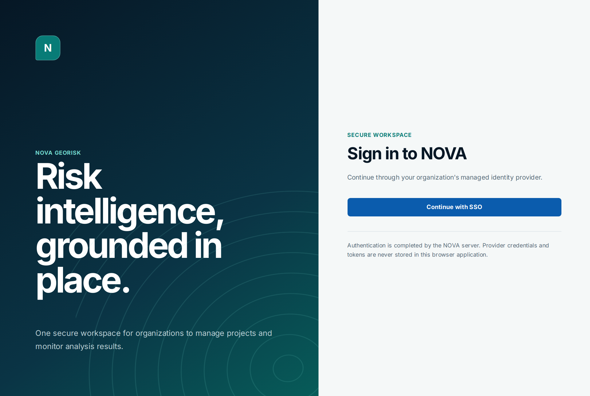

### Choose a system

After signing in you see **Your systems**. **FRRIS** is active; WRRIS and MEGIS are shown as they become available. Choose **Open FRRIS**.

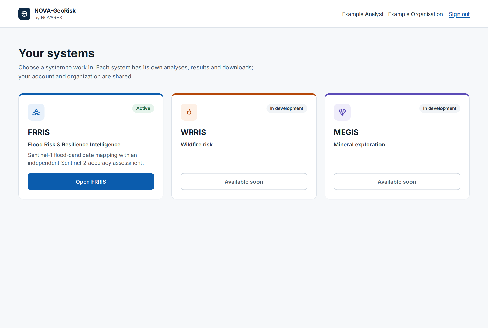

Inside a system, the switcher at the top of the left menu moves you between systems. Your account, organisation and projects are shared; analyses, results and downloads belong to each system.

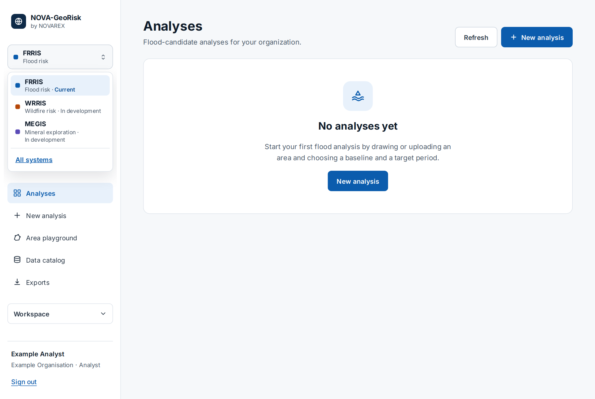

### Roles

Your role is set by your organisation and shown under your name at the bottom of the menu.

| Role | What it allows |
|---|---|
| **Owner** | Everything an admin can do, and manages the other admins. |
| **Admin** | Manages members and their roles, and reviews external data; can run analyses. |
| **Analyst** | Creates projects and areas, runs analyses and downloads results. |
| **Viewer** | Opens results and downloads; cannot start analyses. |

## 2. Area playground

The **Area playground** is where you draw or upload an area and check that it fits one analysis before you save it.

### Draw or upload

::: steps
1. In the left menu choose **Area playground**.
2. Draw with **Polygon** or **Rectangle**, or choose **Upload GeoJSON / Shapefile / KML** (a Shapefile is uploaded as one .zip file).
3. Read the box under the map: **Area**, **Box** (the rectangle around your area) and **Resolution**.
:::

::: tip
The download size depends on the **box**, not only on the area. A long, diagonal shape can be small but still too large for one analysis.
:::

### Fits one analysis?

The panel on the right estimates the download size against the 48 MiB limit of one Earth Engine request. If the area is too large, FRRIS offers three ways to make it fit:

- **Trim** to the largest box that fits. You can then move the box with **West**, **North**, **South** and **East**.
- **Split** into parts. Each part is saved as its own area and run as its own analysis.
- **Use a coarser resolution** (for example 90 m or 120 m). This keeps the whole area, but the map has less detail.

Choose an option and press **Apply**.

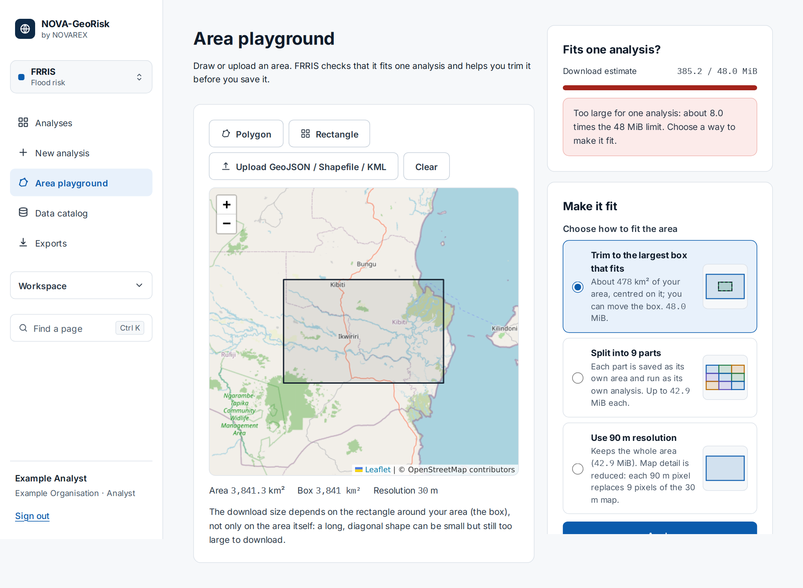

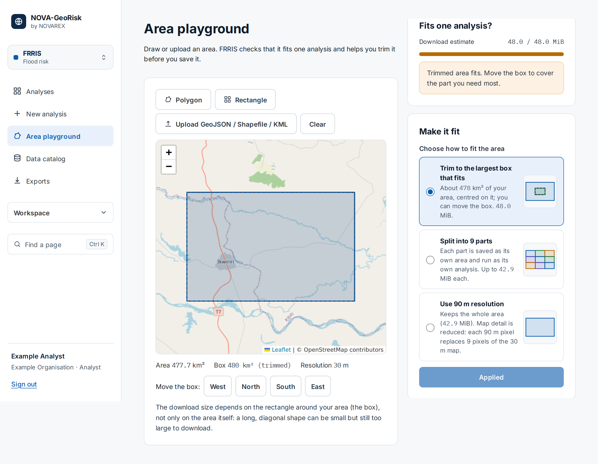

### Save the area

::: steps
1. When the panel says the area fits, type a **Name** (for example "Rufiji floodplain 2024").
2. Choose the **Project**.
3. Press **Save to my areas**. Saved areas appear in **New analysis**.
:::

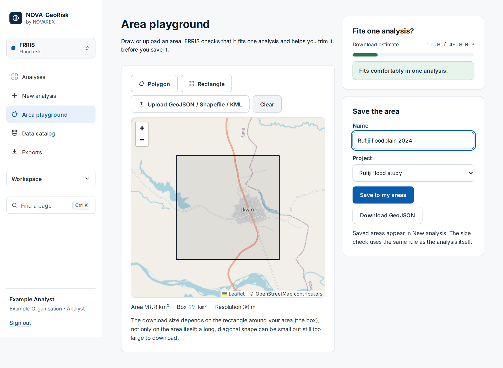

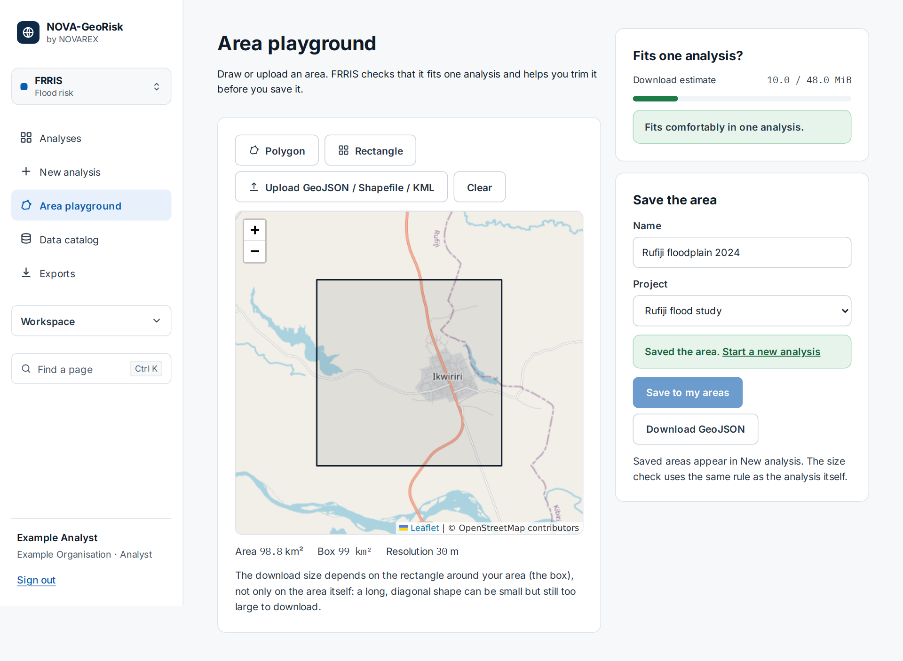

## 3. New analysis

Choose **New analysis** in the left menu. The form has five steps; the **Run summary** on the right always shows what will be run.

### Step 1: Project and area

Choose the **Project** and then the **Area**. You can also draw or upload a new area from here.

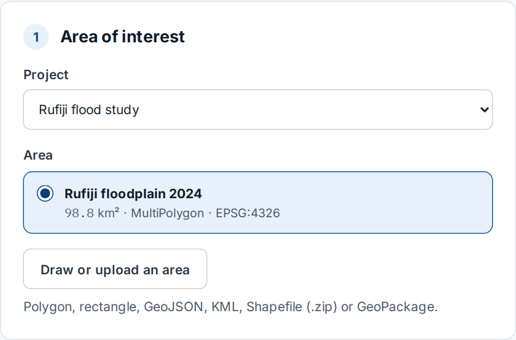

### Step 2: Target and baseline dates

- **Target (flood event):** the days of the flood you want to map.
- **Baseline (dry season):** a dry period before the event, ideally the same season of an earlier year or the end of the last dry season.
- **The last day is included.** "24–25 May 2024" means both days.
- **One orbit in both windows.** Sentinel-1 passes over the same place about every 12 days. FRRIS needs a pass from the **same relative orbit** in both windows (Rufiji: orbit 57, ascending).

### Reading the preflight

As soon as the area and both windows are set, FRRIS checks the satellite archive (no data is downloaded yet). The result appears under the dates:

| You see | Meaning | What to do |
|---|---|---|
| Green **Ready** | A Sentinel-1 pass from one orbit in both windows; the size fits. | Continue. |
| Blue **warning** | The run can go ahead, but something limits it, for example no clear Sentinel-2 scene, so the accuracy will not be assessable. | Decide: widen the window, or continue. |
| Red **Cannot run with these dates** | For example, no Sentinel-1 pass in the window, or different orbits. | Change the dates, or press **Use nearest pass**. |

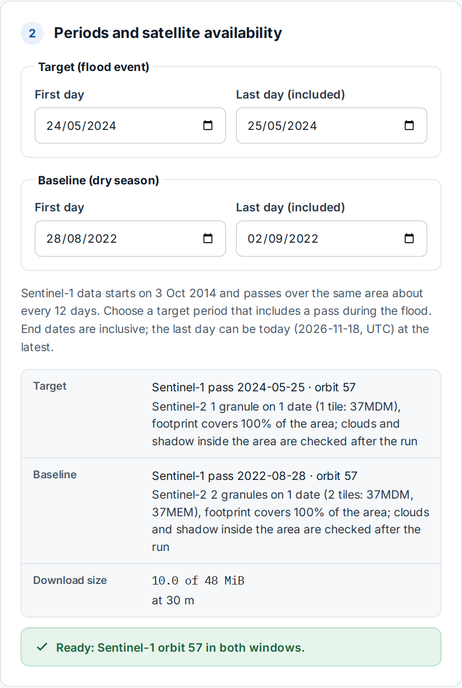

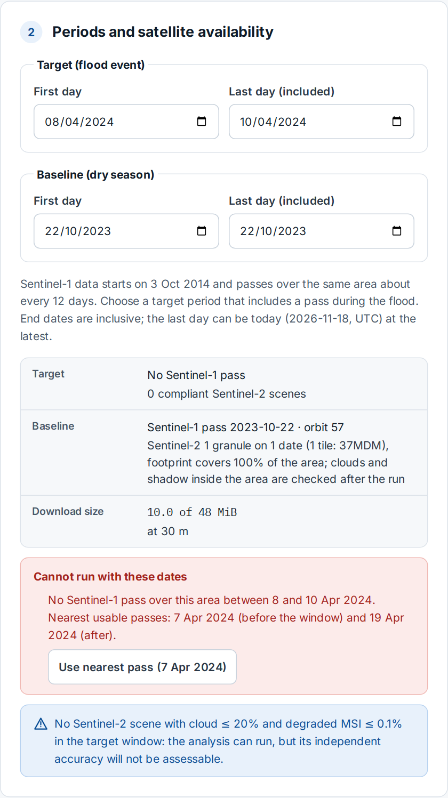

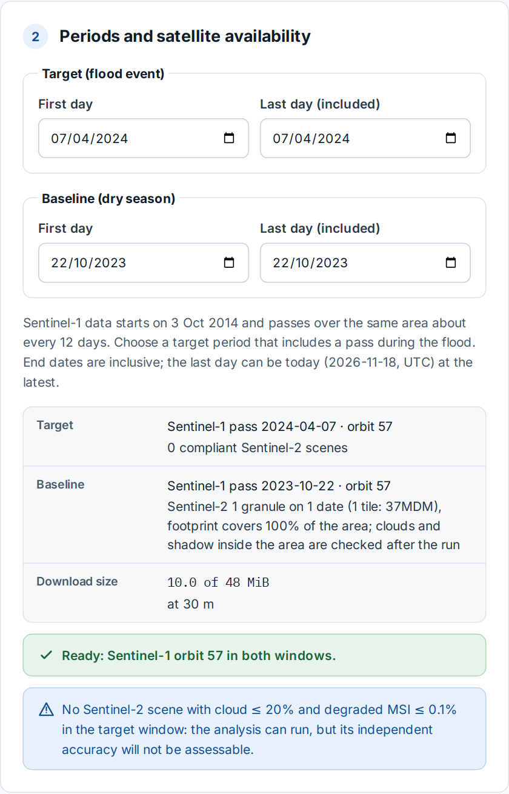

**Sentinel-1 coverage.** FRRIS needs radar from one orbit over the **whole** area. If a pass covers only part of it (an area at the edge of the swath), the preflight blocks the run.

**Sentinel-2 "footprint" coverage.** The line "footprint covers 100% of the area" means the scene **footprints** cover the area. It does **not** mean the area is cloud-free: the scene cloud figure (≤ 20%) is measured over the whole 110 × 110 km tile. **Clouds and cloud shadow inside your area are checked after the run.**

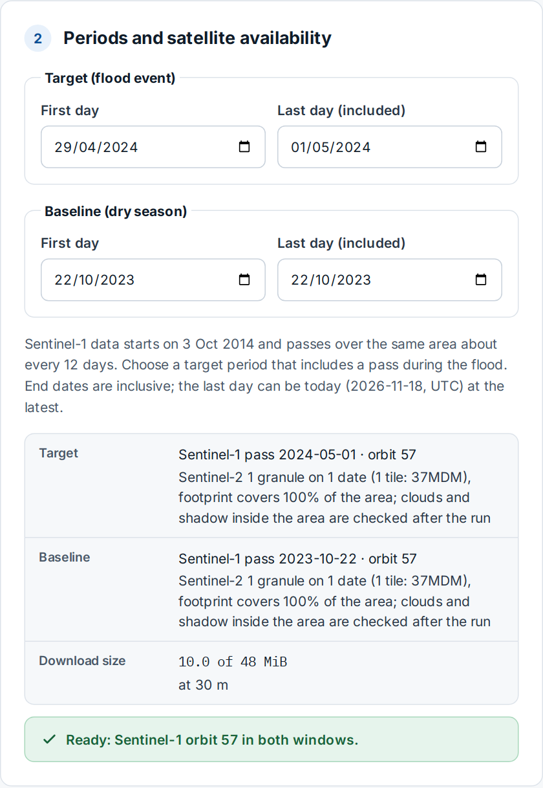

### Step 3: Data quality

The maximum Sentinel-2 cloud cover (default 20%) can be changed. The minimum area coverage (70%) and the degraded-pixel limit (0.1%) are fixed. The model features are listed for information: Sentinel-2 is never a model input; it is used only as the independent reference.

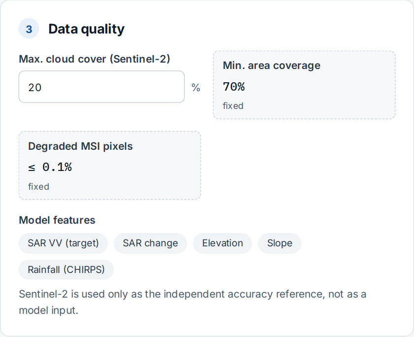

### Step 4: Products

| Product | What you get |
|---|---|
| **Flood-candidate extent** | The map of pixels classified as flood candidates (GeoTIFF, COG, vector, framed map). |
| **Model confidence score** | The Random Forest vote fraction for each pixel (0 to 1). It is a model score, not a calibrated probability. |
| **Modelled flood hazard (GloFAS v2.1)** | Modelled river-flood depth for 10- to 500-year return periods. Context next to the flood map, not an observation. |
| **Estimated exposure (WorldPop, Open Buildings)** | People and buildings inside the flood candidates and inside each modelled zone. Switches on the hazard, which it needs. |

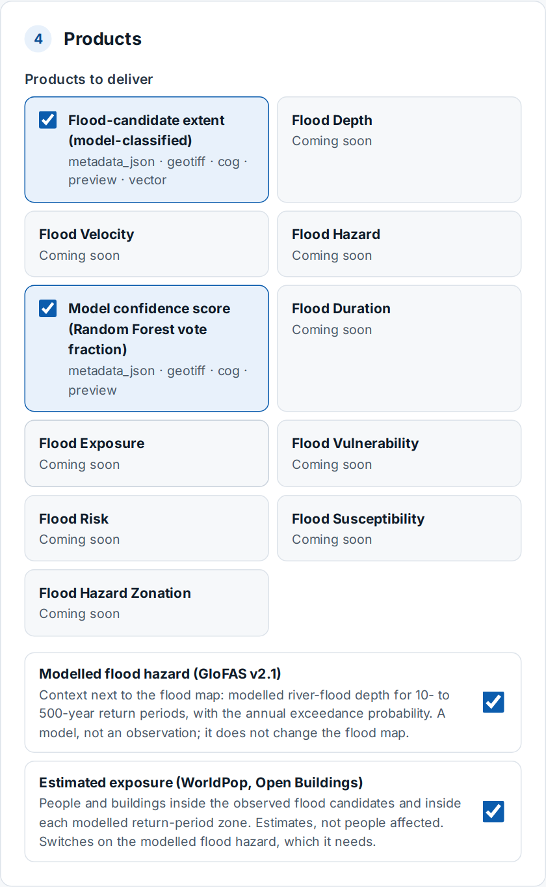

### Run

Check the **Run summary**, then press **Run analysis**. Step 5 (sampling) can stay on the recommended values.

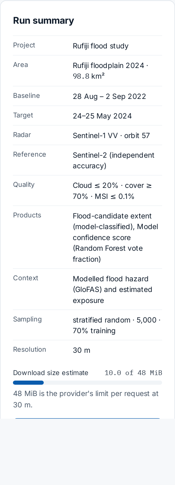

## 4. Following a run

After **Run analysis** the analysis page opens. It shows the progress and the six stages of a run. A 100 km² area usually takes several minutes. You can leave the page: the analysis keeps running and appears under **Analyses**.

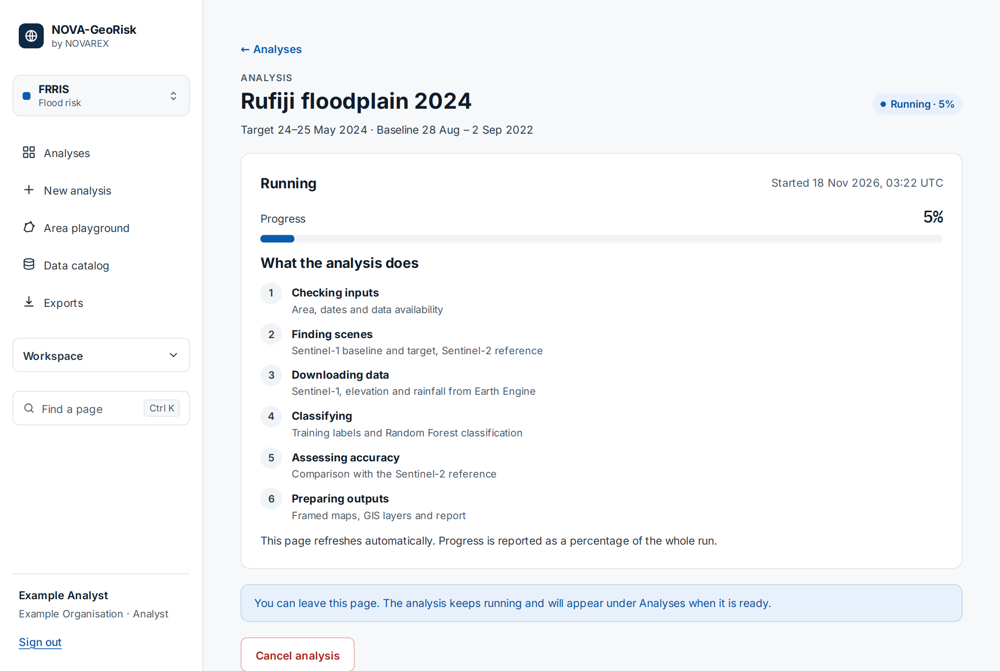

The **Analyses** page lists every analysis with its status. Open a finished one to see its results.

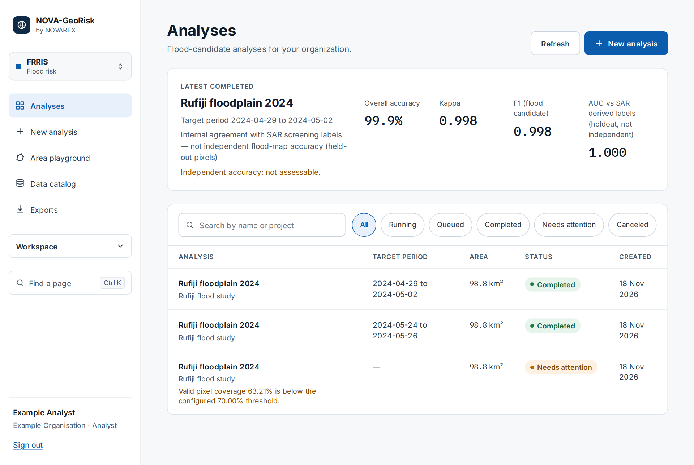

### When a run fails

FRRIS stops a run when the data would not support a reliable map, and says why in plain words: for example, "Not enough valid radar data over the area", or "The radar pass does not cover the whole area".

::: steps
1. Read the message and the explanation under it.
2. Press **Edit and retry**. The form opens with the same settings.
3. Change what the message points to (usually the dates, or a smaller area) and run again.
:::

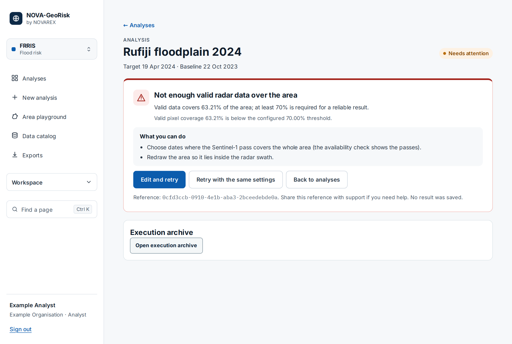

## 5. Results

A result has these tabs: **Overview**, **Accuracy assessment**, **Modelled hazard** and **Exposure** (when chosen), **Downloads & GIS layers**, **Provenance**, **Map viewer**, **Metrics** and **Execution**.

### Overview

The headline gives the flood-candidate area and its share of the valid analysed area, the dates and the main maps.

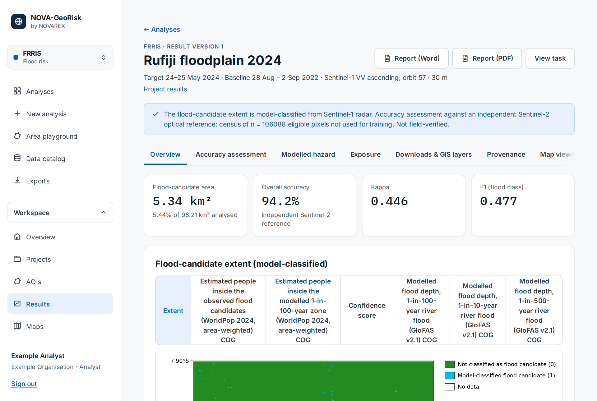

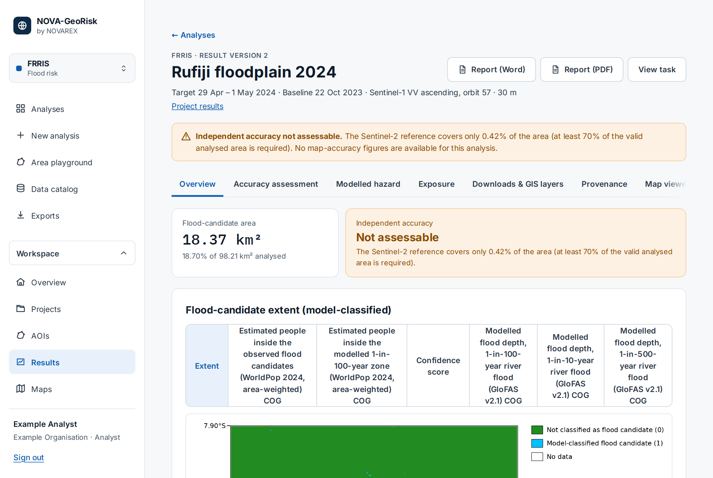

### Accuracy assessment

There are two kinds of figures. Only one of them is map accuracy.

| | What it is | Is it map accuracy? |
|---|---|---|
| **Independent (Sentinel-2)** | The map compared with a Sentinel-2 optical flood reference that the model never saw, over every eligible pixel (a census). | **Yes.** Not field-verified. |
| **Internal agreement** | The map compared with the SAR screening labels it was trained on (held-out pixels). | **No.** Shown for transparency only. |

The May 2024 run, against the independent Sentinel-2 reference:

| Figure | Value |
|---|---|
| Eligible reference pixels | n = 106,088, covering **98.8%** of the analysed area |
| Overall accuracy | 94.2% |
| Cohen's kappa | 0.446 |
| User's accuracy, flood | 48.9% (about half of the mapped flood candidates were flooded in the reference) |
| Producer's accuracy, flood | 46.5% |
| ROC AUC (RF vote fraction vs Sentinel-2) | 0.805 |

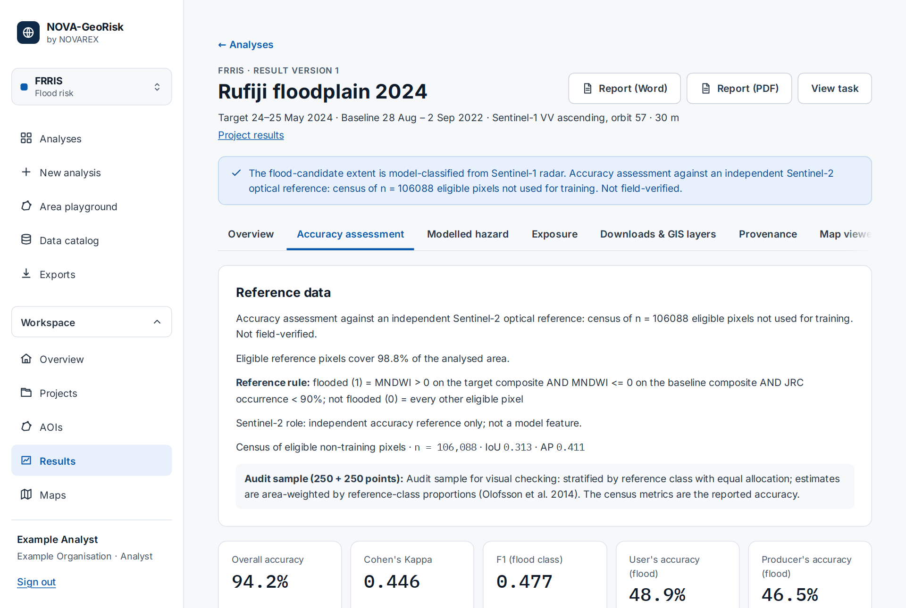

**AUC labels.** Every AUC says what it is measured against, for example "AUC vs Sentinel-2 reference (independent)" or "AUC vs SAR-derived labels (holdout, not independent)". Only the first is evidence of map accuracy.

**Per-variable ROC.** The report and the workbook also show a ROC curve for each model variable against the same Sentinel-2 reference (May 2024 run: SAR VV backscatter 0.893, elevation 0.878, the model score 0.805, SAR change 0.783, slope 0.513). A variable with a high AUC separates flood from non-flood on its own; it does not mean the model is better than its score.

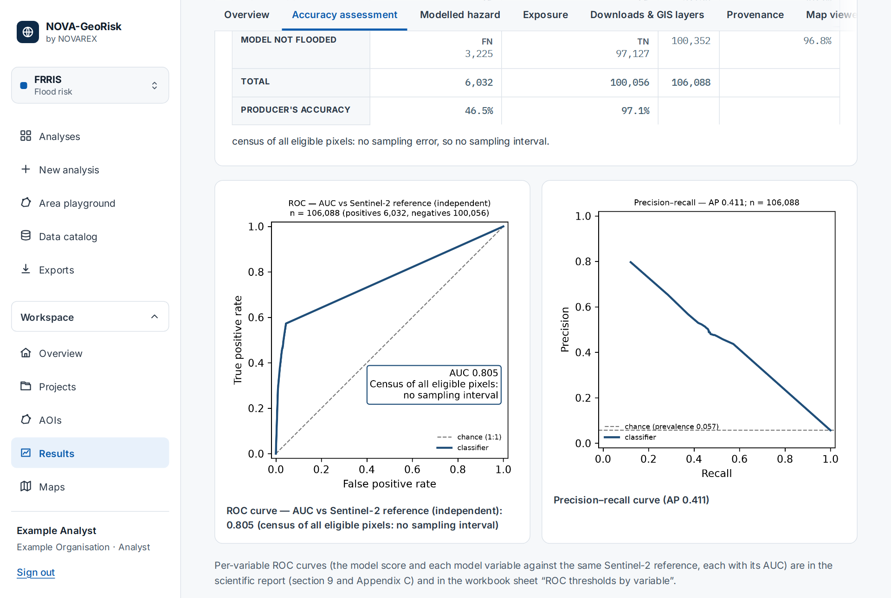

**Reference coverage and "not assessable".** Every result states how much of the area the reference covers: "Eligible reference pixels cover X% of the analysed area". If the reference covers **less than 70%** of the valid analysed area, the accuracy is **not assessable**, and no overall accuracy, kappa or AUC is shown. Figures from such a small sample would not represent the map.

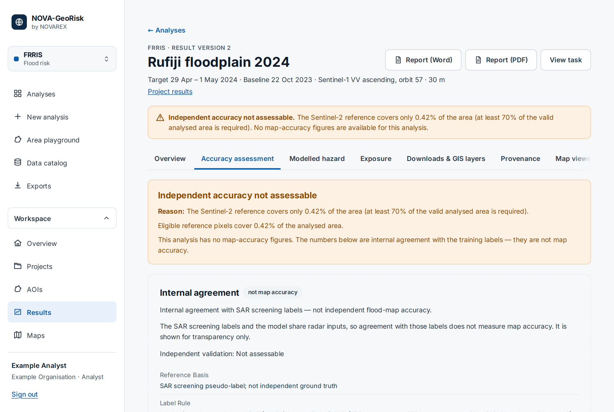

::: caveat
"Not assessable" is not a failure of the flood map. It means there is no reliable independent check for this date. The map can still be used, with that limitation stated.
:::

### Modelled hazard

The **Modelled hazard** tab shows the GloFAS v2.1 river-flood hazard maps for the area. They are a **model**, not an observation of this event.

- **Return period (T):** the 1-in-T-year river **discharge**. The depth is the modelled inundation for that discharge.
- **AEP (annual exceedance probability)** = 1/T. A 1-in-100-year flood has AEP 1% in any year.
- **Probability of at least one occurrence in n years** = 1 − (1 − 1/T)ⁿ. For example, the 1-in-100-year discharge has a 26% chance of occurring at least once in 30 years, and 63% in 100 years.
- **Permanent water** is not flooding. It is shown in grey and excluded from the figures.

For the Rufiji area (98.8 km²), the modelled wet area grows from 26.4 km² (1-in-10) to 31.1 km² (1-in-100) and 32.4 km² (1-in-500). At 1-in-100 years the median depth of the wet cells is 1.79 m (maximum 3.41 m). 65.5% of the peak run's flood candidates lie inside the 1-in-100-year zone.

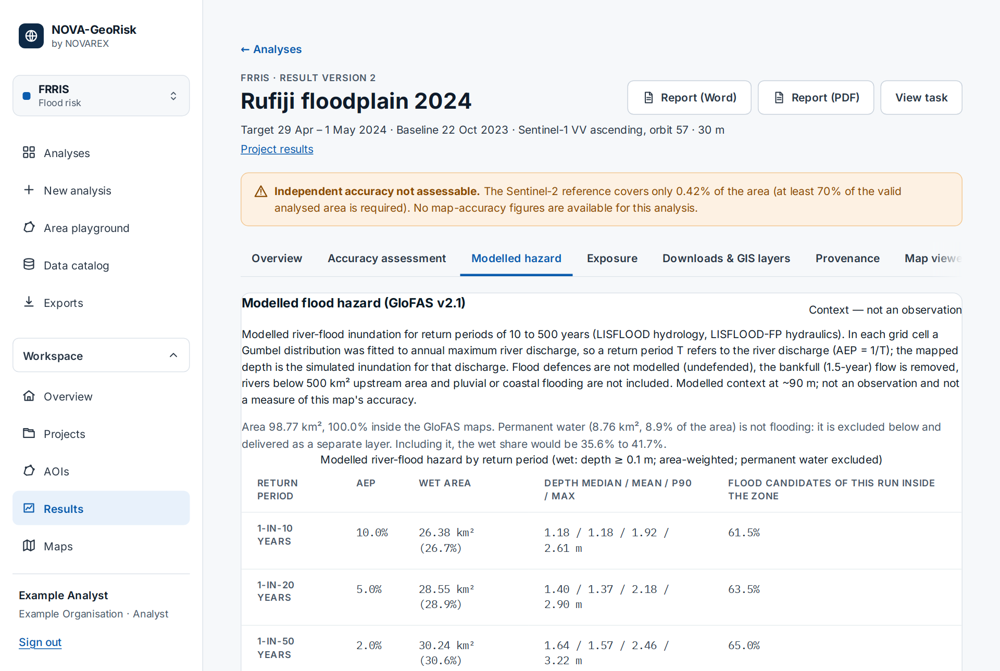

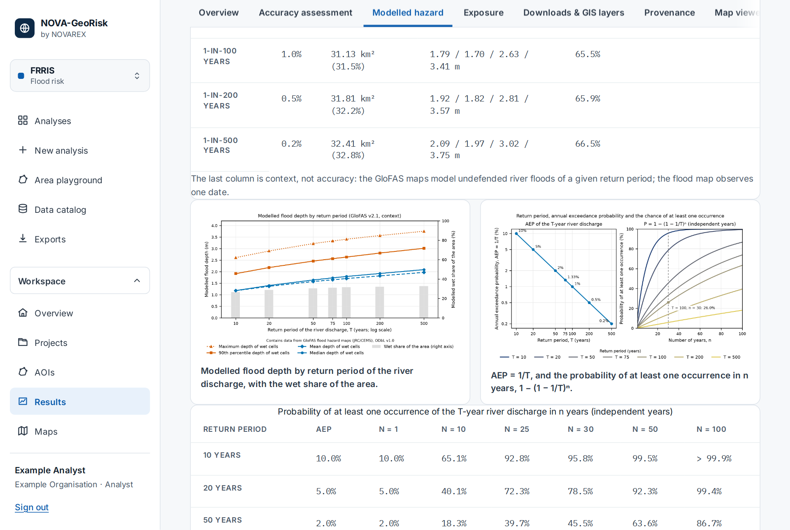

::: caveat
GloFAS models **river** floods only. It is undefended (flood defences are not modelled), at about 90 m, for rivers with more than 500 km² upstream area. It does not model local rainfall (pluvial) or coastal flooding.
:::

### Exposure

The **Exposure** tab estimates the people and buildings inside the observed flood candidates and inside each modelled return-period zone.

| Extent (peak run) | Area | People (estimate) | Buildings, confidence ≥ 0.75 |
|---|---|---|---|
| Whole area | 98.8 km² | 57,361 | 7,461 |
| Observed flood candidates | 18.37 km² | 1,988 | 269 |
| Modelled 1-in-100-year zone | 31.13 km² | 823 | 37 |

- **An estimate, not people affected.** People come from WorldPop R2025A 2024, area-weighted on 100 m cells. For Tanzania, 2024 is a projection two years after the 2022 census. Buildings are counted from Google Open Buildings v3 (the building's centre inside the extent).
- **The commission-error caveat.** The people and buildings inside the observed flood candidates inherit the flood map's commission error. For the May 2024 run, about half of the mapped flood candidates (user's accuracy 48.9%) were flooded in the reference. For the peak run the commission error is not assessable (reference coverage 0.42%). Built-up areas may contain false positives: about half of these people are in the town of Ikwiriri, where radar change can be unrelated to flooding.

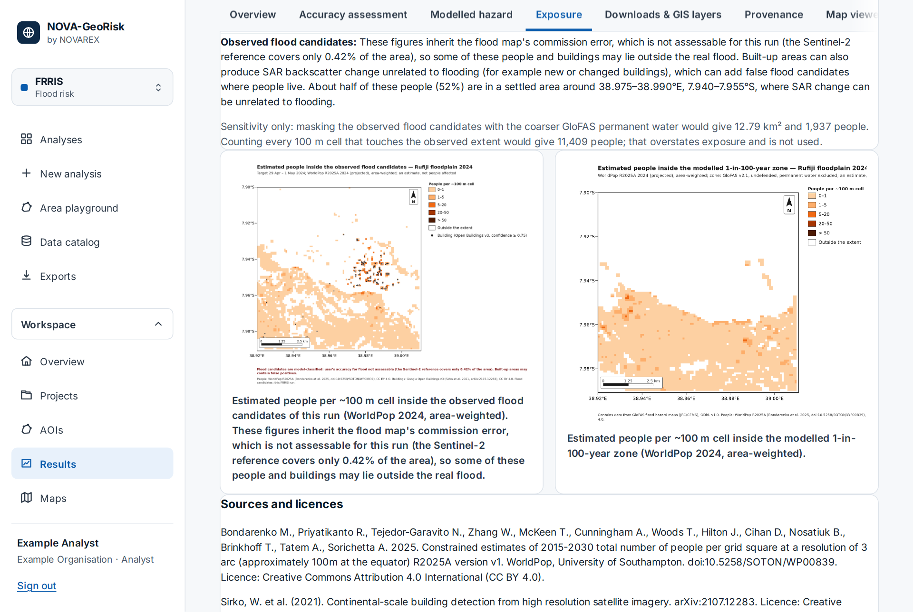

### Map viewer

The **Map viewer** shows the result layers over a basemap: the flood-candidate extent, the confidence score, the modelled depths, permanent water and the people layers. Switch layers on and off and compare two layers side by side.

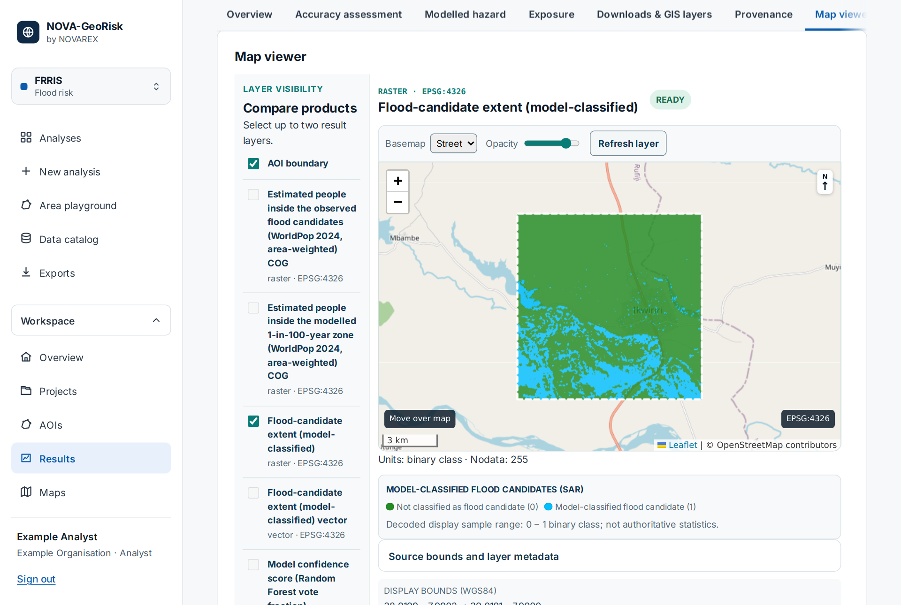

### Downloads & GIS layers

Downloads are grouped: the **report** (PDF and Word), the **package** (everything in one .zip), **maps** (PNG and PDF), **GIS layers** (GeoTIFF/COG, GeoPackage, Shapefile, KML) and **tables** (CSV, Excel).

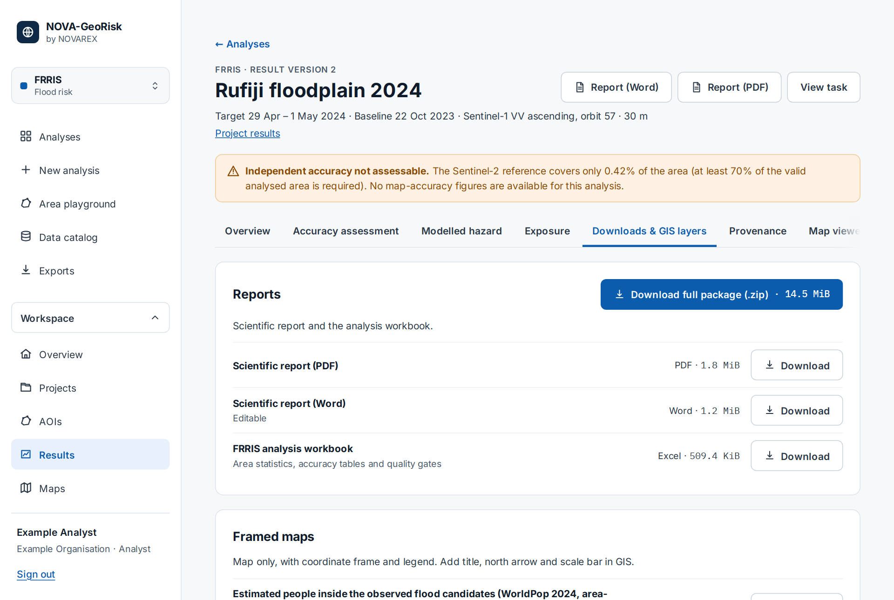

### Provenance

**Provenance** records exactly what was used: the scenes and their dates, the orbits, the quality gates, the model and its settings, and the software version. Use it to cite or repeat an analysis.

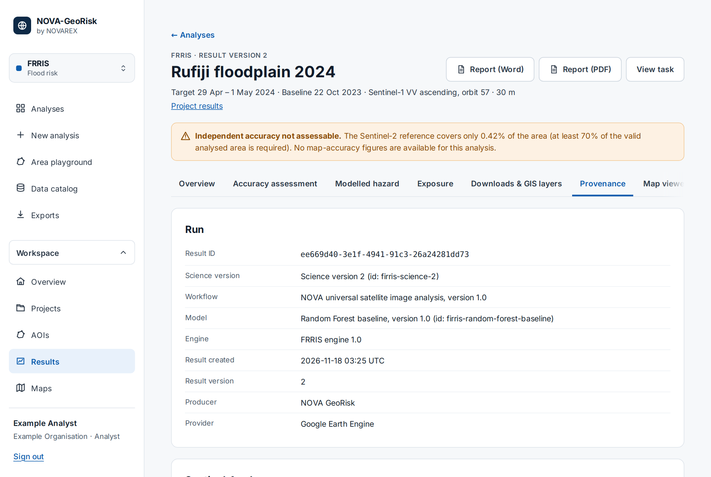

## 6. Reading the scientific report

Every result has a scientific report (PDF and Word). Its sections:

| Section | What it holds |
|---|---|
| 1 Executive summary | The headline area, and the independent accuracy (or why it is not assessable) |
| 2–4 Study area, periods, input data | The area, the dates and every dataset with its credit |
| 5 Method | The screening labels, the classifier and the Sentinel-2 reference rule |
| 6 Quality gates | Each gate with its threshold, the observed value and pass or fail |
| 7–8 Main maps, area statistics | The framed maps and the areas |
| 9 Accuracy assessment | The reference coverage, then the independent tables and ROC (or "not assessable"), then internal agreement |
| 10 Modelled flood hazard *(when chosen)* | GloFAS figures, tables and maps |
| 11 Estimated exposure *(when chosen)* | People and buildings by extent, with the caveats |
| Limitations, provenance | What is not claimed; what was used |
| Appendices | The full accuracy tables, the downloads, and the ROC by variable |

Without the hazard and exposure options, section 10 is Limitations and section 11 is Provenance.

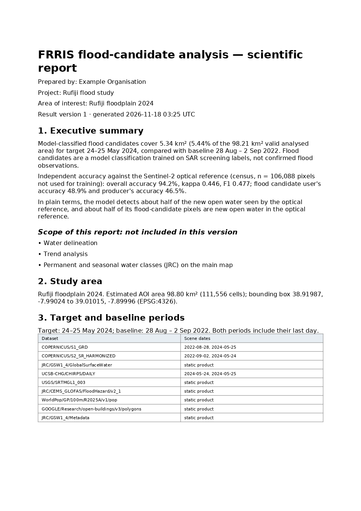

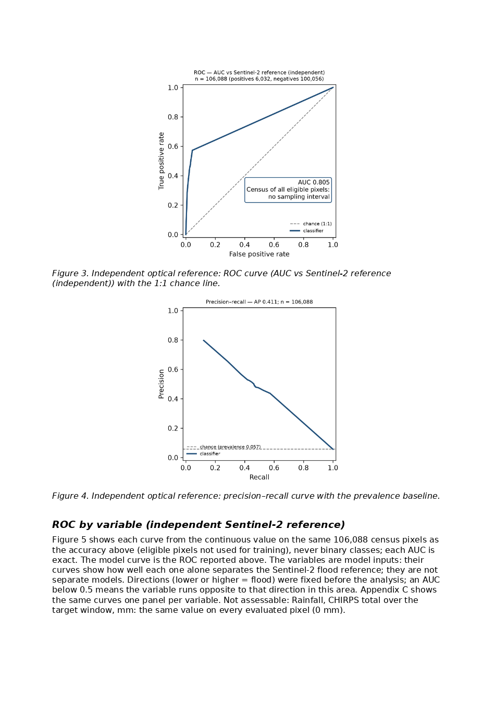

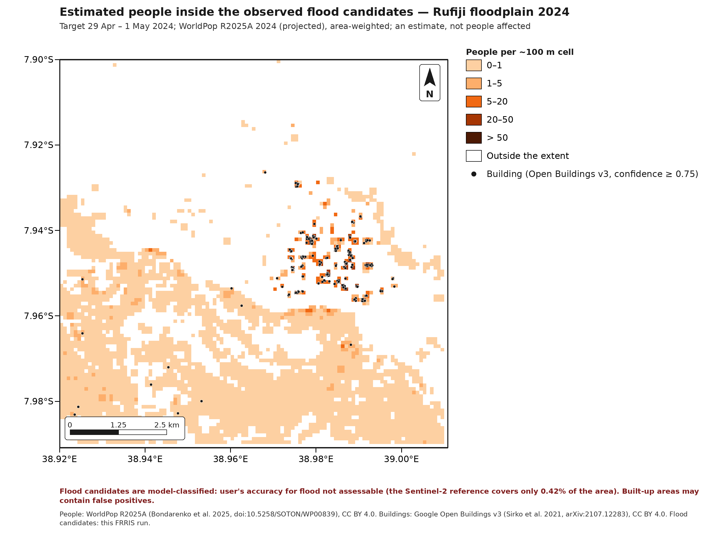

**Key caveats in every report:**

- Flood candidates are **model-classified**, not observed flooding.
- The independent accuracy is against Sentinel-2, **not field-verified**, and only when the reference covers at least 70% of the area.
- Internal agreement is **not** map accuracy.
- The modelled hazard is undefended river-flood context, **not an observation** of this event.
- Exposure is an **estimate**, **not people affected**.

## 7. Good practice

### Choosing dates

- **Target:** include a Sentinel-1 pass **during** the flood. Use the preflight and **Use nearest pass**.
- **Baseline:** a **dry-season** pass on the **same orbit**, before the event. For Rufiji, late in the dry season (for example 22 Oct 2023) works well: the river is at its lowest.
- Look at the Sentinel-2 line of the preflight. If there is no clear scene near the target date, the accuracy will not be assessable.

### Choosing areas

- Keep the **box** small and compact. A diagonal river corridor may need to be split.
- Avoid areas at the edge of a radar swath. The preflight blocks a pass that does not cover the whole area.
- Keep at least 70% of the area with valid data (avoid large areas of steep terrain or radar shadow).

### Why accuracy can be "not assessable"

The independent check needs clear Sentinel-2 pixels **inside your area on both dates**. The scene cloud figure is measured over the whole tile and does not count cloud shadow, so a "10.9% cloud" scene can still be cloudy over your area.

::: caveat
**The April 2024 peak run.** The Sentinel-2 scene of 29 April 2024 had 10.9% cloud over its tile. That cloud was thin cirrus, and it lay over the Rufiji area: only **1.5%** of the area was clear. On the 22 Oct 2023 baseline 36.6% was clear (the rest was cloud and cloud shadow). Only **0.46%** of the area was clear on both dates, and the eligible reference covered **0.42%**. The accuracy is therefore **not assessable**. The flood map itself is unaffected.
:::

### Limits of GloFAS and WorldPop

- **GloFAS v2.1:** a global model at about 90 m. It covers river floods only (no rainfall or coastal floods), is undefended, and covers rivers with more than 500 km² upstream area. Use it as context, not to validate the observed map.
- **WorldPop R2025A:** a modelled population (alpha release), projected after the last census. Small numbers per 100 m cell are uncertain. Report people as an **estimate**.
- **Open Buildings v3:** buildings detected from imagery. Use confidence ≥ 0.75; the count at ≥ 0.65 is a sensitivity check.

## 8. FAQ and contact

**Why are the flood candidates in a town?**
Radar backscatter changes in built-up areas for reasons other than water. Check the Overview and Exposure tabs, the commission-error caveat and the GloFAS comparison.

**Why is there no accuracy figure?**
The reference covered less than 70% of the area, or there was no clear Sentinel-2 scene. See section 7.

**Can I use the confidence score as a probability?**
No. It is the share of Random Forest trees that voted "flood". It ranks pixels; it is not a calibrated probability.

**Why does the preflight say "footprint covers 100%" when the result says the reference covers 0.42%?**
The footprint is the scene outline. Clouds and shadow inside the area are only measured during the run.

**How do I cite a result?**
Use the report's provenance section, and the dataset credits listed in section 4 of the report.

**Who do I contact?**
Contact your NOVAREX project team through the support channel in your service agreement. Please include the analysis name, its date and a screenshot of the message you see.
